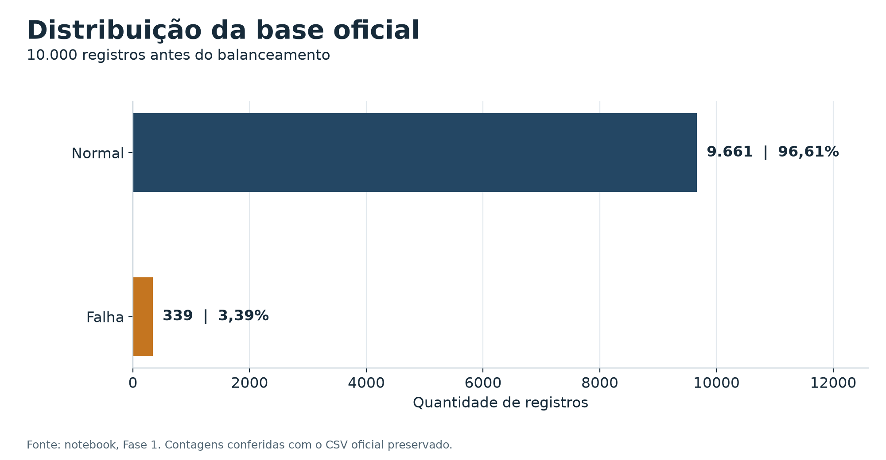
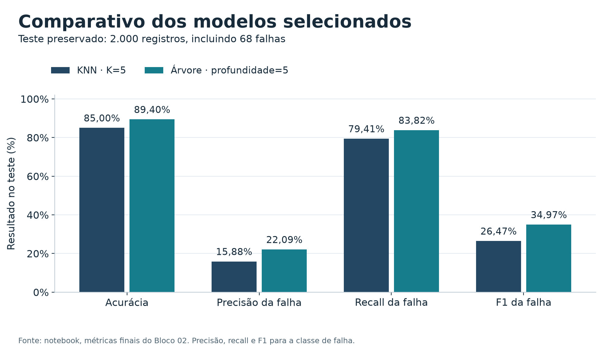
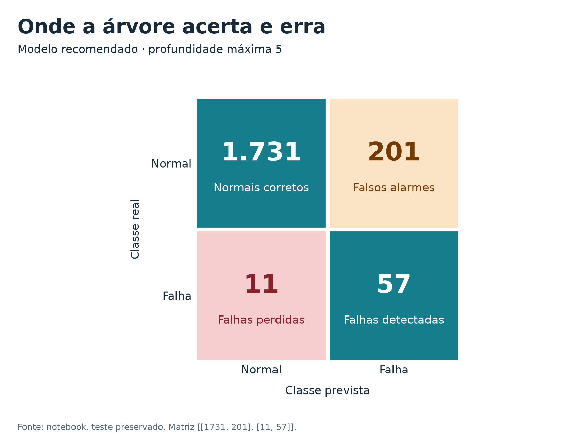

# Manutenção preditiva com IA — Projeto Final T4

**Autor acadêmico responsável:** Fabiano Rodrigo Costa

**Instituição:** SCTEC/SENAI

**Curso:** Desenvolvimento de IA para Análise Preditiva — Turma T4

## Índice

[Apresentação](#apresentacao) · [Contexto](#contexto) · [Problema](#problema) · [Dataset](#dataset) · [Metodologia](#metodologia) · [Resultados](#resultados) · [Negócio](#negocio) · [Limitações](#limitacoes) · [Execução](#execucao) · [Repositório](#repositorio) · [Referências](#referencias)

<a id="apresentacao"></a>
## 01. Apresentação do projeto

Este experimento acadêmico compara KNN e Árvore de Decisão para **classificar a ocorrência de falhas de máquinas a partir de sensores**. O pipeline reúne preparação, engenharia de atributos, balanceamento e avaliação reproduzível em um único notebook.

A **Árvore de Decisão com profundidade máxima 5** foi selecionada pelo F1 médio da validação cruzada, antes de avaliar o teste. Ela identificou **57 das 68 falhas**, com **11 falhas perdidas e 201 falsos alarmes**. Esses resultados apoiam a comparação técnica entre os modelos e exigem avaliação operacional adicional para aplicação industrial.

<a id="contexto"></a>
## 02. Contexto e oportunidade de mercado

- **Mundo.** O World Robotics 2025 registrou cerca de **542 mil robôs industriais instalados em 2024**, mais que o dobro do volume de dez anos antes. Esse avanço amplia a pertinência de estudar dados de equipamentos automatizados. [IFR, 2025](https://ifr.org/news/global-robot-demand-in-factories-doubles-over-10-years/)
- **Brasil.** Na PINTEC Semestral, o uso de IA passou de **16,9% em 2022 para 41,9% em 2024** entre as empresas industriais investigadas, com 100 ou mais pessoas ocupadas. O recorte abrange indústrias extrativas e de transformação. [IBGE, divulgação de 2025 reproduzida pela Agência Gov](https://agenciagov.ebc.com.br/noticias/202509/de-2022-a-2024-percentual-de-empresas-industriais-utilizando-inteligencia-artificial-subiu-de-16-9-para-41-9)
- **Santa Catarina.** O Observatório ACATE 2026 registrou crescimento de **1,8% nos empregos formais de tecnologia em 2025**. A FIESC descreve a diversidade industrial de polos metalmecânicos, de máquinas, equipamentos elétricos e têxteis. Esses ambientes, além do automotivo, oferecem contextos pertinentes para estudos de monitoramento, sujeitos à disponibilidade de dados locais e validação específica. [ACATE, 2026](https://www.acate.com.br/noticias/observatorio-acate-2026-santa-catarina-se-torna-segundo-maior-polo-de-empregos-em-tecnologia-do-brasil/), [FIESC, 2022](https://fiesc.com.br/pt-br/imprensa/sc-tem-quatro-das-100-maiores-cidades-industriais-do-brasil)

<a id="problema"></a>
## 03. Problema de negócio

Detectar condições associadas a falhas pode apoiar a priorização de inspeções e decisões de manutenção relacionadas à continuidade operacional, produtividade e segurança. A decisão precisa ponderar tanto uma falha que passa sem alerta quanto uma inspeção motivada por alarme incorreto.

O alvo `falha_maquina` indica falha (1) ou funcionamento normal (0) no registro. O experimento realiza **classificação de falhas**. Estimar quanto tempo falta para uma quebra requer dados temporais e uma avaliação que este conjunto não oferece. Ganhos financeiros ou operacionais não foram medidos.

<a id="dataset"></a>
## 04. Dataset

Foi utilizado o **CSV oficial fornecido na atividade T4**, acompanhado das anotações do Departamento de Engenharia. O arquivo local contém 10.000 registros e 14 colunas, incluindo ausências em quatro sensores. A origem utilizada neste trabalho é o material da disciplina, sem atribuição a outra base externa. [CSV preservado](data/raw/manutencao_preditiva.csv)

| Papel | Colunas |
| --- | --- |
| Sensores preditores | `temperatura_ar_k`, `temperatura_processo_k`, `velocidade_rotacao_rpm`, `torque_nm`, `desgaste_ferramenta_min` |
| Categoria preditora | `tipo`, com classes L, M e H |
| Alvo | `falha_maquina` |
| Identificadores excluídos dos preditores | `udi`, `id_produto` |
| Histórico de causas excluído dos preditores | `falha_twf`, `falha_hdf`, `falha_pwf`, `falha_osf`, `falha_rnf` |

As causas históricas informam motivos da quebra e produziriam vazamento se usadas para prever o próprio evento. O CSV mantém os dados originais, e as transformações ocorrem em memória.

<a id="metodologia"></a>
## 05. Metodologia

### 1. Análise Exploratória

Dimensões, tipos, `describe()`, distribuição do alvo, histogramas e correlação. A EDA identificou **9.661 registros normais e 339 falhas**.

### 2. Limpeza e Tratamento

Foram encontradas zero duplicatas e **500 ausências em cada coluna** de temperatura do ar, temperatura do processo, rotação e torque. A mediana foi escolhida pela robustez a extremos. Boxplots e IQR identificaram 398 extremos de rotação e 63 de torque, preservados por poderem carregar informação sobre falhas.

### 3. Engenharia de Atributos

Após a imputação, a potência mecânica estimada é calculada por `potencia_mecanica_w = velocidade_rotacao_rpm * torque_nm * 2π/60`, com conversão de rpm para rad/s e resultado em watts.

### 4. Divisão e Balanceamento

Divisão estratificada **80/20**, semente 42. O Random Under Sampling reduz o treino de 7.729 normais e 271 falhas para **271 registros de cada classe**. A subamostragem ocorre novamente dentro de cada treino de dobra. Teste e validação conservam suas distribuições.

### 5. Escalonamento

O KNN recebe StandardScaler apenas nos seis atributos numéricos, incluindo a potência derivada. A árvore mantém a escala original. `tipo` recebe imputação pela moda e One-Hot Encoding com suporte a categorias desconhecidas.

### 6. Ajuste e Controle de Overfitting

Três dobras com `StratifiedKFold`, semente 42. Foram testados K igual a 3, 5 e 7 e profundidades 3, 5 e sem limite. Medianas, moda, codificação, escala e balanceamento são ajustados **dentro dos treinos das dobras**, a partir de `X_treino_bruto`. As escolhas por F1 médio foram K=5 (0,2716) e profundidade=5 (0,3352).

### 7. Avaliação e Veredito

O teste preservado contém **2.000 registros, incluindo 68 falhas**. As seis configurações são comparadas para atender à rubrica, mantendo as escolhas definidas previamente pela validação interna. A avaliação inclui acurácia, precisão, recall, F1, matrizes de confusão e baseline majoritário. [Notebook executado](projeto_final.ipynb), [relatório técnico](docs/relatorio-bloco02.md)

<a id="resultados"></a>
## 06. Resultados e comparativos



**Leitura do gráfico.** Apenas 3,39% dos registros representam falhas. A classe normal domina o conjunto e pode tornar a acurácia enganosa quando analisada isoladamente. A figura representa a base completa antes do balanceamento.



**Leitura do gráfico.** A árvore supera o KNN nas quatro métricas de teste. Ambos detectam parte importante das falhas, mas apresentam baixa precisão dos alarmes. Precisão, recall e F1 referem-se à classe de falha.

| Métrica no teste | KNN, K=5 | Árvore, profundidade=5 |
| --- | ---: | ---: |
| Acurácia | 85,00% | **89,40%** |
| Precisão da falha | 15,88% | **22,09%** |
| Recall da falha | 79,41% | **83,82%** |
| F1 da falha | 26,47% | **34,97%** |
| Falsos negativos | 14 | **11** |
| Falsos positivos | 286 | **201** |

O baseline que sempre prevê funcionamento normal alcança **96,60% de acurácia**, mas deixa passar as **68 falhas**, com recall e F1 iguais a zero.



**Leitura da matriz.** As linhas indicam a classe real e as colunas a previsão. A árvore detectou 57 falhas e perdeu 11. Entre os registros normais, acertou 1.731 e emitiu 201 falsos alarmes. Os números correspondem à matriz `[[1731, 201], [11, 57]]`.

<a id="negocio"></a>
## 07. Interpretação de negócio

- **Acurácia** mede o total de acertos. O baseline demonstra como essa taxa pode ser alta sem detectar uma única falha.
- **Recall** mede quantas falhas foram detectadas. A árvore encontrou 83,82% das 68 falhas do teste.
- **Precisão** mede quantos alarmes corresponderam a falhas reais. Na árvore, foram 57 acertos entre 258 alarmes, ou 22,09%.
- **F1** combina precisão e recall pela média harmônica. Foi o critério previamente escolhido para selecionar as configurações.
- **11 falhas perdidas** representam eventos que passariam sem alerta do classificador. A consequência operacional precisa ser investigada com manutenção e segurança.
- **201 falsos alarmes** podem exigir inspeções desnecessárias e consumir a capacidade da equipe. Esse volume limita o uso operacional dos resultados.

A recomendação da árvore de profundidade 5 decorre do maior **F1 médio de validação cruzada**. O resultado de teste reforça a comparação, mas não foi usado para reajustar os hiperparâmetros. A árvore sem limite acertou 100% do treino balanceado e teve F1 de validação inferior, um indício de sobreajuste documentado no relatório.

<a id="limitacoes"></a>
## 08. Limitações e evolução

- O experimento acadêmico ainda requer validação com dados e condições industriais reais.
- A divisão é aleatória e não demonstra previsão com horas ou dias de antecedência.
- O teste contém apenas 68 falhas, o que limita a precisão das estimativas de desempenho.
- O balanceamento descarta grande parte dos registros normais e reduz o ajuste final a 542 observações.
- A EDA usa a base completa e as seis configurações são expostas ao teste para relatório. Novas otimizações exigiriam avaliação independente.
- Os custos de falhas perdidas e falsos alarmes precisam ser definidos antes de qualquer decisão de implantação.

Como evolução, ampliar os dados, avaliar separações por tempo e equipamento quando houver metadados adequados, estimar a incerteza das métricas e levantar os custos dos erros.

<a id="execucao"></a>
## 09. Como executar

Requisitos verificados no experimento são **Windows, Python 3.12 e acesso ao CSV local**. Abra um terminal PowerShell na raiz do repositório. Com Python 3.12 disponível no launcher do Windows, crie o ambiente se ele ainda não existir.

```powershell
py -3.12 -m venv .venv
.\.venv\Scripts\python.exe -m pip install -r requirements.txt
.\.venv\Scripts\python.exe -m pip check
.\.venv\Scripts\python.exe -m ipykernel install --prefix .venv --name t4-venv --display-name "T4 (.venv)"
.\.venv\Scripts\python.exe -m jupyterlab projeto_final.ipynb
```

No JupyterLab, selecione **T4 (.venv)** e execute **Restart Kernel and Run All Cells**. No VS Code, abra o notebook, selecione o interpretador `.venv\Scripts\python.exe` no seletor de kernel e execute todas as células. O diretório de trabalho deve ser a raiz para resolver `data/raw/manutencao_preditiva.csv`.

A execução registrada no Bloco 02 usa Python 3.12.14, imbalanced-learn 0.14.2, scikit-learn 1.9.1, NumPy 2.5.5 e SciPy 1.18.1. Foram executadas **15 células de código com zero exceções**, em 17,07 segundos na máquina de referência. O tempo varia com o ambiente. [Dependências fixadas](requirements.txt)

Para regenerar somente os PNGs, usando as saídas já salvas no notebook, execute na raiz:

```powershell
.\.venv\Scripts\python.exe docs\gerar_graficos.py
```

<a id="repositorio"></a>
## 10. Organização do repositório

```text
.
├── README.md
├── projeto_final.ipynb
├── requirements.txt
├── data/raw/manutencao_preditiva.csv
└── docs/
    ├── assets/                     # Três gráficos usados neste README
    ├── gerar_graficos.py            # Reproduz as figuras sem novo treinamento
    ├── checklist-rubrica.md         # Critérios e pendências da entrega
    └── relatorio-bloco02.md         # Evidências técnicas e métricas completas
```

`main` recebe a versão final, `develop` concentra a integração e `feature/*` organiza as etapas de trabalho. Os blocos de preparação e modelagem foram integrados a `develop`. A documentação está em `feature/documentacao-executiva` e aguarda revisão e integração. [Checklist da entrega](docs/checklist-rubrica.md)

O prazo da atividade é **16/11/2026 às 22h, horário de Brasília**. Os critérios oficiais e as pendências de submissão estão registrados no checklist da entrega.

<a id="referencias"></a>
## 11. Referências e autoria

- Enunciado T4 e anotações do Departamento de Engenharia, materiais oficiais da atividade. A base utilizada está versionada no repositório. [Dataset](data/raw/manutencao_preditiva.csv)
- IFR, World Robotics 2025, dados de instalações referentes a 2024. [Divulgação oficial](https://ifr.org/news/global-robot-demand-in-factories-doubles-over-10-years/)
- IBGE, PINTEC Semestral, dados de 2022 e 2024, divulgação em 24/09/2025. [Texto do IBGE reproduzido pela Agência Gov](https://agenciagov.ebc.com.br/noticias/202509/de-2022-a-2024-percentual-de-empresas-industriais-utilizando-inteligencia-artificial-subiu-de-16-9-para-41-9)
- FIESC, descrição dos polos industriais catarinenses, publicação de 20/12/2022. [Fonte](https://fiesc.com.br/pt-br/imprensa/sc-tem-quatro-das-100-maiores-cidades-industriais-do-brasil)
- ACATE, Observatório ACATE 2026, dados de emprego referentes a 2025, divulgação em 27/08/2026. [Fonte](https://www.acate.com.br/noticias/observatorio-acate-2026-santa-catarina-se-torna-segundo-maior-polo-de-empregos-em-tecnologia-do-brasil/)

Autoria acadêmica responsável de **Fabiano Rodrigo Costa**. Os resultados e as figuras deste repositório representam o experimento documentado no notebook.
